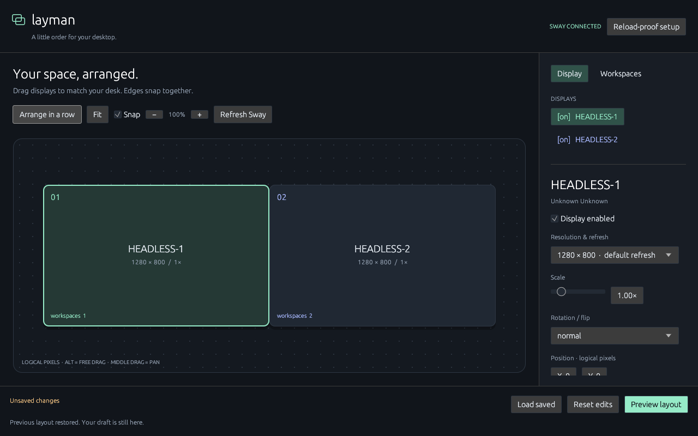

# Layman

A small native display-layout editor for **Sway**, written in Rust with egui.
No GTK, Qt, Electron, webview, or external `swaymsg` process in the application.
Wayland and OpenGL connect to the normal system graphics libraries.



## Run

Requires Linux, Sway, Rust 1.89+, and your system's Wayland/OpenGL libraries.

```sh
cargo run --locked
# Or explore without a Sway session or changing settings:
cargo run --locked -- --demo
```

For regular use, install at a stable path **before** saving your layout:

```sh
cargo install --path . --locked
layman
```

Drag monitors to match your desk. Edges snap; Alt bypasses snapping. Select a
monitor to edit its advertised resolution/refresh, fractional scale, rotation,
or exact position in logical pixels. Arrow keys over the canvas nudge the
selected monitor; Shift nudges by 10 pixels. Middle-drag pans; Fit recenters.
The workspace tab assigns current and future workspaces to enabled displays.

**Preview layout** applies the draft for 20 seconds. **Keep & save** makes it
persistent; Revert, timeout, or closing/crashing the editor restores the previous
outputs and workspace placement. A separate Rust helper handles rollback even
when the UI has gone away. It runs only during a preview. Changes must leave at
least one connected display enabled. Overlaps and disconnected edges show hints.

## Survive Sway reloads

After Keep & save, add this line **at the end** of your Sway config, after any
other output/workspace rules:

```sway
include ~/.config/layman/sway.conf
```

If you use a custom `XDG_CONFIG_HOME`, get the correct absolute include line
with `layman --print-config`, or copy it from the app's “Reload-proof setup”.
The app does not edit your Sway config automatically.

Layman writes `layout.json` and `sway.conf` to `$XDG_CONFIG_HOME/layman`, defaulting
to `~/.config/layman`. The include applies enabled display settings synchronously
on reload and uses `exec_always /absolute/path/to/layman --restore` to restore
existing workspaces. Workspace moves carry tiled and floating windows together;
the existing tiling tree stays intact. Future workspace assignments are also
in the include. Existing workspace focus is restored after moves.

**No systemd service or permanent daemon needed.** Sway owns the lifecycle.
Keep the binary at the saved absolute path; save again if you move/reinstall it
somewhere else. Connected displays with known serials are matched by make/model/
serial, so connector renumbering can be resolved. Others use connector names.
Unknown connected outputs are left alone; missing saved outputs/workspaces are
skipped by restore. Disabling runs through the restore helper, with a check for
an enabled connected saved display, so an unplugged dock cannot make the include
disable your only remaining laptop screen. Restore refuses obsolete advertised
modes and leaves the session available for editing. To restore after plugging a
monitor in, run `layman --restore` or reload Sway. Automatic hotplug monitoring
and multiple named profiles are not included.

Both saved files use staged writes and atomic replacement; a failed second
replacement restores the previous include. They are two files, so a machine
crash between replacements is not a transaction across both. A process lock
serializes previews/restores and is automatically released after process exit.
Names containing Sway command metacharacters are rejected before applying.

## Command line

```sh
layman --inspect       # Read-only JSON of current displays and workspaces
layman --restore       # Apply saved settings to connected outputs/workspaces
layman --print-config  # Print the include line
layman --demo          # Sample desktop; no IPC or saved-setting writes
layman --help
```

## Tests

```sh
cargo fmt --check
cargo clippy --all-targets -- -D warnings
cargo test --locked
cargo test --locked --test headless -- --ignored --nocapture
```

The headless test needs `sway`, `grim`, and Mesa software EGL/OpenGL. It starts
its **own** two-output compositor with a private runtime directory and IPC
socket, isolates configuration writes, renders the actual native UI, captures
`artifacts/headless-ui.png` and `headless-preview.png`, tests dragging and
Arrange → Preview → Keep with a real virtual Wayland pointer, moves a workspace
with a live Wayland window,
checks save/reload, and waits out the real 20-second rollback deadline. It
never sends commands to your desktop session. Ordinary tests cover IPC framing,
validation, device matching, logical dimensions/snapping, persistence, and UI
rendering without a display server. CI runs both suites.

Protocol and behavior references: [Sway IPC](https://github.com/swaywm/sway/blob/master/sway/sway-ipc.7.scd),
[output commands](https://github.com/swaywm/sway/blob/master/sway/sway-output.5.scd),
and [workspace/include/exec_always commands](https://github.com/swaywm/sway/blob/master/sway/sway.5.scd).
